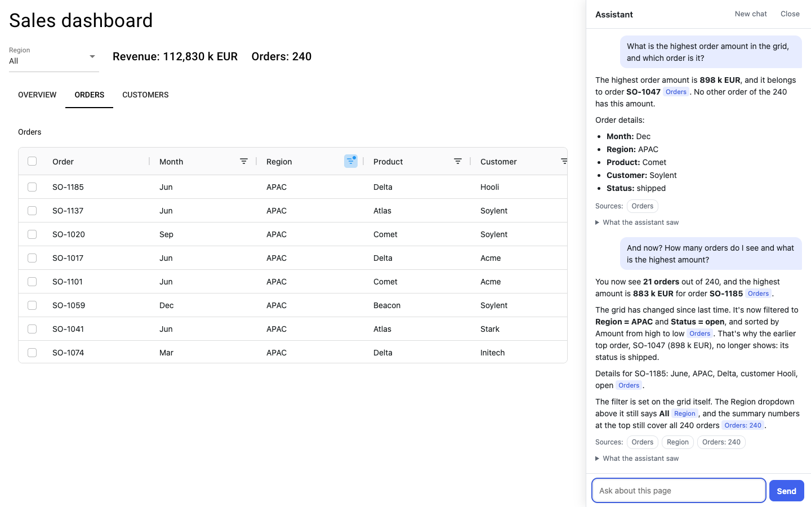
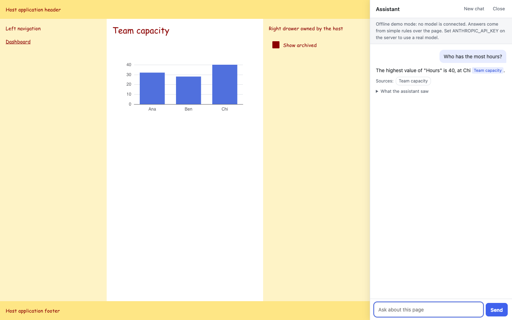

# Glimpse

Add an AI assistant that can see the page to your [NiceGUI](https://nicegui.io) app, in one line.

```python
from nicegui import ui
import glimpse

@ui.page('/')
def dashboard():
    ui.echart({...})
    ui.aggrid({...})
    glimpse.attach()    # That's it

ui.run()
```

Users get a side panel where they can ask about what is on their screen. The assistant reads the live page when they ask, including their filters, sort order, selected tab and chart zoom. You do not annotate anything or pass it any data.



> **Status: 0.1, an early MVP.** Capture, the panel and the security defaults are tested in a real browser. With Claude Opus 5.5, it answered all 26 reference questions correctly, in one run on a single dashboard with a simple scorer. That is a good early sign, not a full evaluation. See [known limits](docs/known-limits.md).

## Try it

No API key is needed. Without one, the panel runs in a clearly labelled offline demo mode that answers from simple rules over the page.

```bash
git clone https://github.com/axnsantana/glimpse-ai && cd glimpse-ai
conda env create -f environment.yml && conda activate glimpse
python examples/02_sales_dashboard.py
```

For real answers, set `ANTHROPIC_API_KEY` or `OPENAI_API_KEY` on the server, or run a local model. See [Choosing a model](docs/models.md).

## Examples

Each one is a small runnable app, and each one runs in the test suite as it ships.

| | Example | Shows |
|---|---|---|
| 01 | [Quickstart](examples/01_quickstart.py) | One line, and answers that follow the screen |
| 02 | [Sales dashboard](examples/02_sales_dashboard.py) | `ui.echart`, `ui.plotly`, `ui.aggrid`, `ui.table`, inputs and tabs, with no annotations |
| 03 | [Large data](examples/03_large_data.py) | 200,000 points inside a 6,000-token budget |
| 04 | [Multi-page apps](examples/04_multi_page.py) | One call for a whole app, including sub pages |
| 05 | [Existing layouts](examples/05_existing_layout.py) | Sharing a page with drawers and hostile CSS |
| 06 | [Custom engines](examples/06_custom_engine.py) | Your own agent, in as little as one async generator |
| 07 | [Choosing a model](examples/07_choose_your_model.py) | Cloud or local models, prompts, usage and limits |
| 08 | [Privacy and security](examples/08_privacy_and_security.py) | Secrets stay out, and a compromised model cannot exfiltrate data |
| 09 | [Developer context](examples/09_developer_context.py) | Adding what the screen cannot show |
| 10 | [Two users](examples/10_two_users.py) | Sessions that never see each other |

## What makes it different

Passing data to a chat function by hand works until users start filtering. Then a hand-wired assistant answers from all the rows while the user looks at a few. Glimpse reads the view the user actually has, on each question.

| | |
|---|---|
| **Sees the applied view** | Grid filters and sort, chart zoom and hidden series, table sort, inputs and tabs |
| **Stays inside a budget** | Large tables and series become statistics computed in Python, plus a visible "Showing 50 of 12,000 rows" and read-only tools to fetch more |
| **Shows its work** | "What the assistant saw" under each answer, and sources that scroll to the element used |
| **Safe by default** | Passwords withheld, hidden text ignored, images and external links in answers disabled, sessions isolated |
| **Your model** | Claude, OpenAI, local models, or your own agent. No cloud service of ours, and no agent framework required |
| **Small** | NiceGUI is the only required dependency |



## How it works

```text
Page (NiceGUI) -> Adapter -> PageContext -> Context builder -> Engine -> Model -> Sanitizer -> Panel
```

Everything runs in your NiceGUI process. Read [Data flow](docs/data-flow.md) to see what goes where.

## Docs

- [Getting started](docs/getting-started.md)
- [Choosing a model](docs/models.md)
- [Data flow](docs/data-flow.md)
- [Visibility policy](docs/visibility-policy.md): what counts as "seen"
- [Security and privacy](docs/security.md)
- [Known limits](docs/known-limits.md)
- [Versioning](docs/versioning.md)
- [NiceGUI internals](docs/nicegui-internals.md)
- [Requirements status](docs/requirements-status.md): each SRS requirement and its evidence
- [Going public](docs/going-public.md): the steps to release the code and publish the presentation page in `site/`

## Development

```bash
conda env create -f environment.yml && conda activate glimpse
pytest                # Fast tests, including every example
pytest -m e2e         # Real Chrome against the real examples
ruff check src tests examples
```

`pytest -m live` scores a real model on the reference question set (about $0.35 on Claude Opus 5.5) and checks real requests against the budget with the free token counting endpoint. See [tests/test_fidelity.py](tests/test_fidelity.py).

## License

[MIT](LICENSE)
